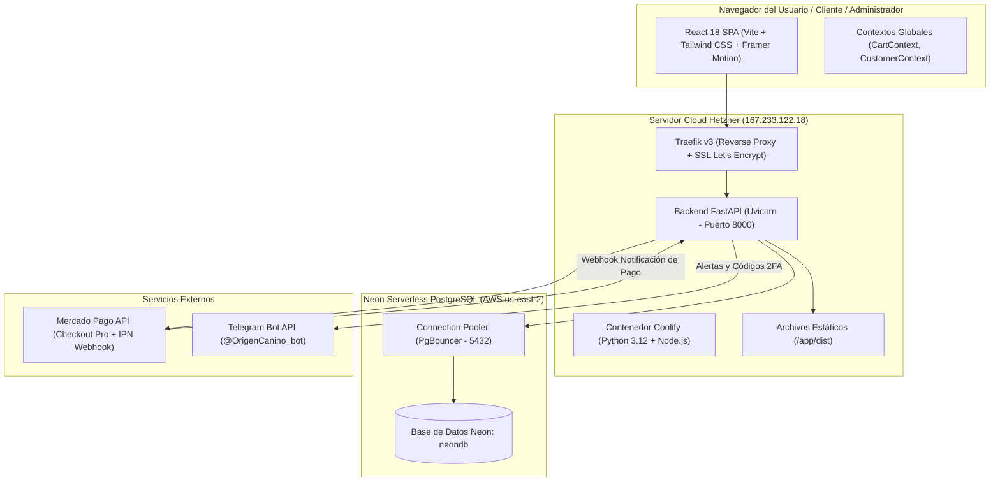
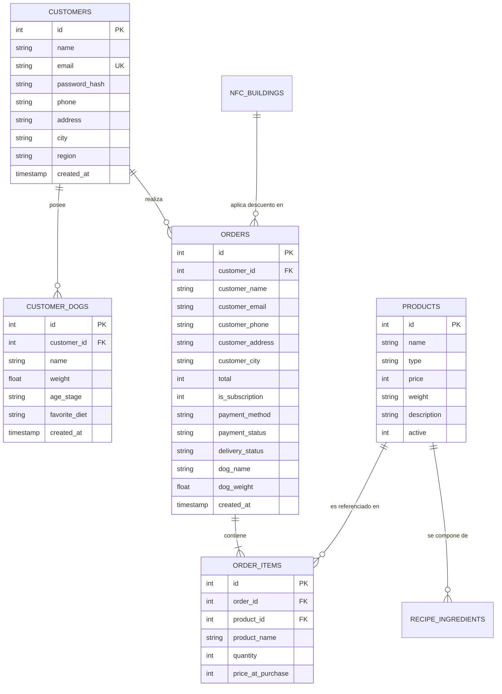

# 🏗️ ARQUITECTURA TÉCNICA Y GUÍA DEL SISTEMA — ORIGEN CANINO 2

Este documento describe la arquitectura global, infraestructura, flujo de datos, integraciones de terceros y mapa de navegación de código de la plataforma **Origen Canino**. Está diseñado como referencia técnica definitiva para el equipo de desarrollo y mantenedores.

---

## 1. 🗺️ Diagrama de Arquitectura Global



---

## 2. 🖥️ Infraestructura y Servidor de Producción

| Parámetro | Detalle |
| :--- | :--- |
| **Proveedor de Hosting** | Hetzner Cloud VPS |
| **Dirección IP** | `167.233.122.18` (Usuario: `root`) |
| **Dominio Principal** | `https://origencanino.cl` / `https://www.origencanino.cl` |
| **Certificados SSL** | Let's Encrypt (Automático vía Traefik v3) |
| **Gestor de Aplicaciones** | Coolify v4 (Docker Swarm / Compose autónomo) |
| **Nombre del Servicio** | `t3axkro5sddkevfhqih195r4` |
| **Directorio de la App en Contenedor** | `/app` (backend en `/app/backend`, frontend en `/app/dist`) |

### Comandos de Despliegue y Administración en el Servidor
```bash
# 1. Conexión SSH al servidor
ssh root@167.233.122.18

# 2. Identificar el ID del contenedor activo de Origen Canino
docker ps --filter "name=t3axkro5sddkevfhqih195r4" --format "{{.ID}} - {{.Names}} ({{.Status}})"

# 3. Ver registros (logs) en tiempo real de la aplicación
docker logs -f <CONTAINER_ID> --tail 100

# 4. Reiniciar el servidor FastAPI (Uvicorn) tras actualizar archivos
docker exec <CONTAINER_ID> pkill -f uvicorn
```

---

## 3. 🗄️ Base de Datos: Neon PostgreSQL

La base de datos opera bajo arquitectura Serverless en Neon (`ep-noisy-queen-ayv7un86-pooler.c-5.us-east-2.aws.neon.tech`), utilizando PgBouncer como gestor de conexiones por transacción con SSL forzado (`sslmode=require`).

### Modelos y Tablas del Sistema



### Detalle de las Tablas Principales:
1. **`products`**: Catálogo de la tienda.
   - `type`: `'barf'`, `'cocinada'`, `'snack'`.
   - `weight`: Formato textual dinámico (`'1 Kg'`, `'400 g'`, `'500 ml'`). **Crucial:** No se debe hardcodear nunca el peso en el frontend, siempre se consume desde este campo.
2. **`orders`**: Pedidos registrados.
   - `is_subscription`: `1` si el cliente eligió suscripción mensual recurrente, `0` si es compra única.
   - `payment_status`: `'Pendiente (Mercado Pago)'`, `'Pendiente (Transferencia)'`, `'Pagado (Mercado Pago)'`, `'Pagado (Transferencia Confirmada)'`.
3. **`customers`**: Cuentas de clientes registrados.
   - `email`: Almacenado en minúsculas con índice único para búsquedas rápidas.
   - `password_hash`: Encriptado con bcrypt.
4. **`customer_dogs`**: Registro de mascotas asociadas al cliente.
   - Permite que un cliente tenga 1 o varios perros con peso y etapa de vida independientes.
5. **`system_settings`**: Almacén clave-valor para credenciales bancarias y tokens de Mercado Pago.
6. **`admin_security_logs`**: Auditoría de acceso administrativo con IP, User-Agent, fecha y resultado.

---

## 4. 🔌 Integraciones Externas

### A. Pasarela Mercado Pago (Checkout Pro & Webhooks)
- **Modo:** Producción comercial.
- **Razón Social:** `TASTYBARF` (ID Colector: `2223011524`).
- **Access Token:** Gestionado dinámicamente en base de datos (`system_settings`) o variable de entorno.
- **Flujo de Pago:**
  1. En checkout, si el usuario elige Mercado Pago, se invoca `POST /api/payments/mercadopago/create-preference`.
  2. El backend crea la preferencia con ítems, costos de despacho y URL de retorno (`https://origencanino.cl/?payment=success`).
  3. El usuario es redirigido a Mercado Pago para abonar con tarjeta de crédito, débito o dinero en cuenta.
  4. Una vez procesado, Mercado Pago envía un webhook a `https://origencanino.cl/api/webhooks/mercadopago`.
  5. El backend consulta a la API de Mercado Pago (`https://api.mercadopago.com/v1/payments/{payment_id}`) para verificar autenticidad y actualiza el pedido a `Pagado (Mercado Pago)`.

### B. Bot Oficial de Telegram (`@OrigenCanino_bot`)
- **Token Oficial:** `9089876682:AAFeQDNJLqt7qGodbf7EH3fh5gTHlMH2FSQ`
- **Chat ID Destino:** `1468481915` (Patricio Padilla)
- **Funcionalidades:**
  1. **2FA Administrativo:** Envío de código numérico de 6 dígitos con expiración de 5 minutos al iniciar sesión en el panel.
  2. **Notificación de Pedidos:** Alerta instantánea cuando un cliente realiza una compra, desglosando productos, cantidades, peso, dirección y método de pago.
  3. **Alertas de Suscripción:** Marca especial cuando una compra tiene activada la entrega mensual programada para coordinar con el cliente.
  4. **Confirmación de Pagos:** Alerta cuando un pago de Mercado Pago es acreditado vía webhook.

---

## 5. 🧭 Mapa de Navegación del Código (¿A dónde voy cuando necesito cambiar algo?)

| Si necesitas modificar... | Archivos Frontend | Archivos Backend / DB |
| :--- | :--- | :--- |
| **Catálogo de Productos, Precios o Fotos** | `src/components/shop/ProductCard.jsx`<br>`src/components/shop/Home.jsx` | `backend/main.py` (`/api/products`)<br>Tabla `products` |
| **Pesos, Gramajes y Unidades de Medida** | `src/components/shop/CartDrawer.jsx`<br>`src/components/shop/CheckoutModal.jsx` | Campo `products.weight`<br>`backend/main.py` (`OrderItem`) |
| **Lógica del Carrito y Regla de los 10 kg** | `src/components/shop/CartDrawer.jsx`<br>`src/context/CartContext.jsx` | `backend/main.py` (`create_order`) |
| **Suscripción Mensual Recurrente** | `src/components/shop/CartDrawer.jsx`<br>`src/components/shop/CheckoutModal.jsx` | `backend/main.py` (`is_subscription`) |
| **Portal del Cliente (`/mi-cuenta`) y Repetir Pedidos** | `src/components/customer/CustomerPortal.jsx`<br>`src/context/CustomerContext.jsx` | `backend/main.py` (`/api/customer/*`)<br>Tablas `customers`, `customer_dogs` |
| **Autocompletado y Selector de Mascotas en Checkout** | `src/components/shop/CheckoutModal.jsx`<br>`src/components/customer/CustomerAuthModal.jsx` | `backend/main.py` (`/api/customer/dogs`) |
| **Pasarela Mercado Pago o Datos Bancarios** | `src/components/shop/CheckoutModal.jsx` | `backend/main.py` (`/api/payments/mercadopago/*`, `/api/settings/bank-transfer`) |
| **Panel de Administración, Recetas o Finanzas** | `src/components/admin/AdminPanel.jsx`<br>`src/components/admin/ProductRecipeManager.jsx` | `backend/main.py` (`/api/admin/*`)<br>`backend/server_db.py` |
| **Seguridad de Acceso Admin y 2FA Telegram** | `src/components/admin/SecurityManager.jsx` | `backend/main.py` (`/api/auth/*`, `notify_telegram`) |

---

## 6. 🛠️ Diagnóstico Técnico, Puntos Críticos y Mejoras Recomendadas

### ⚠️ Observaciones en la Base de Datos Identificadas
1. **Falta de Sistema Formal de Migraciones:**
   - Actualmente las tablas se crean en `backend/server_db.py` con sentencias `CREATE TABLE IF NOT EXISTS`.
   - *Problema:* Cuando se agrega una nueva columna (como ocurrió con `customer_id` en `orders` o `weight`), `CREATE TABLE IF NOT EXISTS` no modifica las tablas ya existentes en Postgres, requiriendo `ALTER TABLE` manual.
   - *Mejora Recomendada:* Incorporar **Alembic** para versionar las migraciones de base de datos de manera determinista y reproducible.

2. **Optimización de Índices en PostgreSQL:**
   - A medida que aumente el volumen de pedidos, se deben crear índices explícitos en las columnas más consultadas:
     ```sql
     CREATE INDEX IF NOT EXISTS idx_orders_customer_id ON orders(customer_id);
     CREATE INDEX IF NOT EXISTS idx_orders_email ON orders(LOWER(customer_email));
     CREATE INDEX IF NOT EXISTS idx_customer_dogs_cust ON customer_dogs(customer_id);
     CREATE INDEX IF NOT EXISTS idx_order_items_order ON order_items(order_id);
     ```

3. **Congelamiento Histórico del Peso en `order_items`:**
   - En este momento, `order_items` guarda `product_id`, `product_name`, `quantity`, `price_at_purchase`.
   - Para evitar que si el producto cambia de presentación en el futuro altere la lectura de pedidos antiguos, se recomienda agregar la columna `product_weight VARCHAR(50)` directamente en `order_items`.

4. **Sincronización de Variables de Entorno (`.env`):**
   - El archivo local `backend/.env` tiene la conexión directa a Neon. Se debe asegurar que las variables (`DATABASE_URL`, `TELEGRAM_BOT_TOKEN`, `JWT_SECRET`) estén siempre respaldadas en la interfaz de variables de entorno de Coolify para que ante cualquier reconstrucción total del contenedor persistan intactas.

5. **Evolución Futura: Mercado Pago Preapproval (Débito Automático Directo):**
   - Actualmente, la suscripción mensual registra el compromiso recurrente, aplica el 10% de descuento y despacho gratis, y notifica a la empresa para contactar al cliente antes de cada despacho.
   - *Siguiente Paso:* Implementar la API de **Mercado Pago Subscriptions / Preapproval** para que los clientes puedan suscribir su tarjeta de crédito y el cargo se efectúe de forma 100% automatizada cada 30 días.
