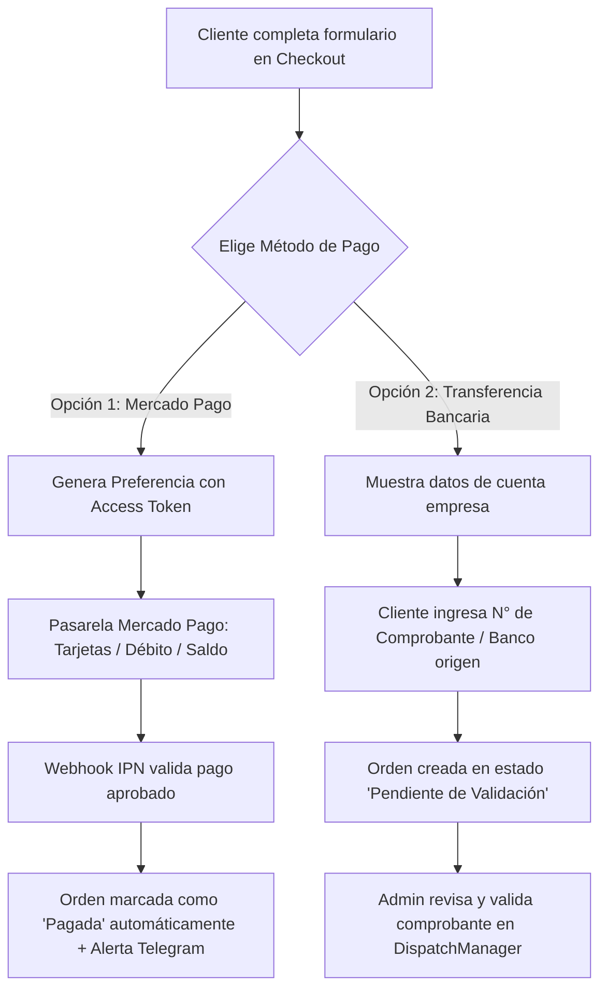

# 🐾 BITÁCORA V2: PLAN DE ACCIÓN Y ESPECIFICACIÓN TÉCNICA — ORIGEN CANINO 2
**Fecha:** 31 de Octubre, 2026  
**Aprobado por:** Patricio Padilla (PPV Soluciones)  
**Proyecto:** `origen-canino-2` (`/home/patricio/Documentos/origen-canino-2`)  
**Enfoque:** E-Commerce de Alimento Natural (BARF & Dieta Cocinada) + Panel Admin + Mercado Pago + Red NFC en Condominios

---

## 1. 🧹 Depuración Inmediata: Eliminación Total del SaaS Criaderos

El módulo de "Criaderos" no pertenece a este proyecto y se introdujo por error en el directorio de trabajo. Será removido por completo para no contaminar la arquitectura:

- **Archivos a eliminar / descartar del proyecto:**
  - `backend/routers/criaderos.py`, `backend/routers/dogs.py`, `backend/routers/litters.py`.
  - `backend/models.py` (modelos de criaderos/perros de criadero), `backend/database.db`.
  - `src/components/saas/` (todas las vistas y layouts de criaderos).
  - `src/context/SaasAuthContext.jsx`.
- **Limpieza de `src/App.jsx`:**
  - Remover todas las rutas `/criaderos`, `/criaderos/registro` y `/saas/*`.
  - Restaurar la estructura limpia y enfocada 100% en el E-commerce y su Panel de Administración.

---

## 2. 🏪 Restauración Integral del Backend de la Tienda (`backend/main.py`)

Se restaurará y validará la versión completa del backend original (998 líneas, 35+ endpoints), asegurando el funcionamiento inmediato de:
- **Catálogo:** `/api/products` (CRUD de productos, subida de fotos WebP, variantes BARF / Cocinada / Snacks).
- **Inventario y Recetas:** `/api/admin/ingredients`, `/api/admin/products/{id}/recipe`, cálculo de costos fijos y costo unitario.
- **Nutrición:** `/api/admin/products/{id}/nutrition`, integración con IA para análisis de etiqueta garantizada.
- **Finanzas y Retención:** `/api/admin/finance/report`, `/api/admin/orders`, cálculo de recompra según peso del perro.
- **Blog y Testimonios:** `/api/blog`, `/api/testimonials` (con aprobación en admin).
- **Seguridad y Notificaciones:** 2FA para el acceso admin y alertas automáticas por Telegram a Patricio ante cada evento.

---

## 3. 💳 Integración de Pagos: Mercado Pago + Transferencia Bancaria (Estilo Timbrapp)

Aprovechando la tasa y comisión preferencial que Mercado Pago otorgó a la empresa, el flujo de pago en `CheckoutModal.jsx` ofrecerá dos alternativas claras para el cliente:

### Detalle de Implementación:
1. **Mercado Pago (Online):**
   - Configuración de `MERCADOPAGO_ACCESS_TOKEN` en `backend/.env`.
   - Endpoint `POST /api/payments/mercadopago/create-preference` que emite `preference_id` e `init_point`.
   - Webhook `POST /api/webhooks/mercadopago` que procesa la notificación IPN en tiempo real y pasa el pedido a `Pagado`.
2. **Transferencia Bancaria (Manual con trazabilidad):**
   - En el checkout se muestran los datos de la cuenta corriente de la empresa.
   - El cliente ingresa su banco de origen, número de transferencia o sube comprobante.
   - En el panel de administración (`DispatchManager` / Pedidos) se añade la columna y botón para **"Validar Transferencia"**, permitiendo al operador aprobar el pago con un clic tras verificar en la cuenta bancaria.

---

## 4. 📲 Sistema de Campañas NFC para Condominios y Edificios

Para distribuir chips/tags NFC en recepciones y conserjerías de grandes edificios residenciales, el sistema contará con un módulo administrativo dedicado (idéntico al flujo probado en Timbrapp) para registrar, geolocalizar y trazar cada tag.

### A. Módulo en el Panel de Administración (`AdminPanel.jsx` -> Nueva Pestaña "Puntos NFC"):
Para no perder el rastro de dónde se instaló cada chip cuando haya decenas o cientos de edificios:
- **Campos del registro por cada punto NFC:**
  1. **Nombre del Edificio / Condominio:** (Ej: *"Edificio Los Alerces"*).
  2. **Dirección:** (Ej: *"Av. Las Condes 1234"*).
  3. **Referencias de Calle (Clave para ubicación en terreno):** (Ej: *"Esquina con San Damián, frente a la plaza de perros"*).
  4. **Código Identificador / Slug:** (Ej: `los-alerces`).
  5. **Descuento Exclusivo:** (Ej: `15%`).
  6. **Contacto Conserjería / Administración:** (Opcional, teléfono o conserje a cargo).
- **Herramientas del Administrador:**
  - Botón directo **"Copiar Enlace NFC"** con la URL lista para grabar en el chip con la app del celular (ej: `https://origencanino.cl/?nfc=los-alerces`).
  - Contador de visitas y pedidos generados por cada edificio.

### B. Experiencia del Vecino al Acercar el Celular al Tag NFC:
1. Al tocar el tag, su teléfono abre `https://origencanino.cl/?nfc=los-alerces`.
2. La web detecta el código, lo guarda en `localStorage` y despliega un modal/banner personalizado:
   > *"¡Hola vecino de **Edificio Los Alerces**! 🐾 Tienes un **15% de descuento exclusivo** en tu primer pedido de alimento natural para tu perro."*
3. Al agregar productos y pasar al Checkout:
   - El descuento del edificio se calcula y descuenta automáticamente.
   - La orden se almacena con `nfc_building_code: "los-alerces"`.
4. **Beneficio Logístico:**
   - En el panel de despachos, Origen Canino puede agrupar todos los pedidos del *"Edificio Los Alerces"* para repartirlos el mismo día en un solo viaje, optimizando costos de transporte y tiempos de entrega.

---

## 5. 🚀 Plan de Ejecución por Etapas

| Etapa | Descripción | Resultado Esperado |
| :--- | :--- | :--- |
| **Fase 1: Limpieza y Restauración** | Eliminar archivos del SaaS Criaderos, limpiar `src/App.jsx` y restaurar `backend/main.py` completo con SQLite/Postgres. | Tienda y Admin 100% funcionales en local sin errores 404. |
| **Fase 2: Mercado Pago & Transferencias** | Implementar SDK de Mercado Pago (preferencia + webhook) y formulario de comprobante de transferencia en Checkout y Admin. | Pagos reales y seguimiento manual operativos. |
| **Fase 3: Campañas NFC en Admin y Frontend** | Crear pestaña "Puntos NFC" en Admin con referencias de calles, detección de `?nfc=` en Home, banner de bienvenida y descuento automático. | Sistema de adquisición y captación en condominios listo. |
| **Fase 4: Verificación y Despliegue** | Pruebas de compra completa (MP + Transferencia + NFC) y verificación de compilación lista para producción. | Plataforma lista para operar comercialmente. |
