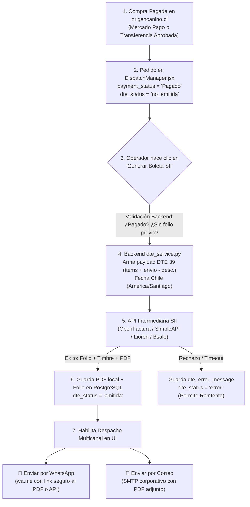

# 🧾 Especificación Técnica de Implementación: Módulo de Boletas Electrónicas (DTE Tipo 39 — SII)

**Proyecto:** Origen Canino (`origencanino.cl`)  
**Fecha:** 15 de Noviembre de 2026  
**Estado:** 🟡 Propuesta Técnica para Revisión (Sin código escrito aún)  
**Ubicación Base:** `backend/main.py`, `backend/server_db.py`, `src/components/admin/DispatchManager.jsx`

---

## 1. Objetivo y Alcance
Implementar la emisión oficial de **Boletas Electrónicas afectas (DTE Tipo 39)** ante el **Servicio de Impuestos Internos (SII)** mediante una API intermediaria autorizada, operada **bajo demanda humana** desde el panel de pedidos (`DispatchManager.jsx`) y con despacho supervisado al cliente por **WhatsApp** y **Correo Electrónico** con PDF firmado.

---

## 2. Arquitectura del Flujo Operativo

---

## 3. Cambios en Base de Datos (`backend/server_db.py`)

Siguiendo el patrón actual de migración idempotente de `server_db.py`, se agregarán columnas a la tabla `orders` y una tabla de auditoría contable:

### 3.1. Nuevas Columnas en `orders`
| Columna | Tipo | Default | Propósito |
| :--- | :--- | :--- | :--- |
| `dte_status` | `TEXT` | `'no_emitida'` | Estado: `'no_emitida'`, `'emitida'`, `'error'`, `'anulada'` |
| `dte_tipo` | `INTEGER` | `39` | Código SII (`39` = Boleta Electrónica Afecta) |
| `dte_folio` | `INTEGER` | `NULL` | Número oficial de folio asignado por el SII |
| `dte_track_id` | `TEXT` | `NULL` | Identificador de envío/seguimiento del proveedor DTE |
| `dte_pdf_url` | `TEXT` | `NULL` | Ruta local protegida del PDF firmado (`/uploads/dtes/...`) |
| `dte_public_token` | `TEXT` | `NULL` | Token único no adivinable (`secrets.token_urlsafe(24)`) para compartir el PDF por WhatsApp |
| `dte_issued_at` | `TIMESTAMP` | `NULL` | Fecha y hora de emisión oficial (Chile) |
| `dte_error_message` | `TEXT` | `NULL` | Último mensaje de error si la API falla |
| `dte_sent_whatsapp_at` | `TIMESTAMP` | `NULL` | Marca temporal del último envío por WhatsApp |
| `dte_sent_email_at` | `TIMESTAMP` | `NULL` | Marca temporal del último envío por Correo |
| `customer_rut` | `TEXT` | `NULL` | Opcional: preparado por si a futuro se solicita boleta nominativa o Factura (Tipo 33) |

### 3.2. Nueva Tabla `dte_audit_logs`
Registra cada intento de emisión, respuesta del proveedor y cada envío por correo/WhatsApp para respaldo del contador y resolución de incidentes:
- `id SERIAL PRIMARY KEY`
- `order_id INTEGER REFERENCES orders(id)`
- `action TEXT` (`'emit_attempt'`, `'emit_success'`, `'emit_error'`, `'send_email'`, `'send_whatsapp'`)
- `provider TEXT` (`'openfactura'`, `'simpleapi'`, `'lioren'`, etc.)
- `folio INTEGER`
- `detail TEXT` (JSON resumido o mensaje de error)
- `created_at TIMESTAMP DEFAULT CURRENT_TIMESTAMP`

---

## 4. Diseño Backend (`backend/dte_service.py` + `backend/main.py`)

### 4.1. Módulo Desacoplado (`backend/dte_service.py`)
Se creará un adaptador limpio para no atar el proyecto a un solo proveedor SII:
- **`DteProvider` (interfaz base)** con adaptador concreto según el proveedor elegido (ej. `OpenFacturaProvider`, `SimpleApiProvider`, `LiorenProvider`).
- **Variables de entorno nuevas en `backend/.env`:**
  - `DTE_PROVIDER` (ej. `openfactura` | `simpleapi` | `lioren`)
  - `DTE_ENV` (`certificacion` | `produccion`) — **fundamental** para probar en *Sandbox/Certificación* antes de emitir folios reales.
  - `DTE_API_KEY` / `DTE_BASE_URL`
  - `EMISOR_RUT`, `EMISOR_RAZON_SOCIAL`, `EMISOR_GIRO`, `EMISOR_DIRECCION`, `EMISOR_COMUNA`
  - `SMTP_HOST`, `SMTP_PORT`, `SMTP_USER`, `SMTP_PASSWORD`, `SMTP_FROM_NAME` (para envío de correo con PDF adjunto).

### 4.2. Endpoints API en `backend/main.py`
Todos los endpoints administrativos protegidos con la autenticación existente de admin (`verify_admin`):

1. **`POST /api/admin/orders/{order_id}/dte/emit`**
   - **Precondiciones estrictas:**
     1. El pedido debe existir y tener `payment_status == 'Pagado'`.
     2. Idempotencia: si `dte_folio IS NOT NULL` y `dte_status == 'emitida'`, **rechaza re-emitir** y devuelve la boleta existente (evita doble tributación por doble clic).
   - **Construcción del DTE 39:**
     - Toma los ítems de `order_items`, suma `shipping_cost` como línea `"Despacho a domicilio"` (si `> 0`) y aplica `discount_amount` (si `> 0`) para que el total de la boleta cuadre **exactamente** con `orders.total`.
     - Usa la fecha local de Chile (`ZoneInfo("America/Santiago")`).
   - **Persistencia local del PDF:** Descarga el PDF devuelto por el proveedor y lo guarda en `backend/uploads/dtes/boleta_39_{folio}_{order_id}.pdf` para garantizar disponibilidad permanente.

2. **`GET /api/dte/public/{dte_public_token}/boleta.pdf`**
   - Endpoint de descarga limpio y seguro (sin exponer IDs secuenciales) para que el botón de **Ver PDF** y el **enlace incluido en el WhatsApp del cliente** abran directamente la boleta timbrada.

3. **`POST /api/admin/orders/{order_id}/dte/send-email`**
   - Verifica que `dte_status == 'emitida'` y que exista el PDF local.
   - Envía correo HTML con identidad de **Origen Canino** a `order.customer_email` adjuntando `Boleta_OrigenCanino_{folio}.pdf`.
   - Actualiza `dte_sent_email_at` y registra en `dte_audit_logs`.

4. **`POST /api/admin/orders/{order_id}/dte/mark-whatsapp-sent`**
   - Registra `dte_sent_whatsapp_at` y auditoría cuando el operador presiona **"Enviar por WhatsApp"** (y queda preparado para envío directo automático si luego se conecta la instancia de WhatsApp API).

---

## 5. Diseño Frontend (`src/components/admin/DispatchManager.jsx`)

Dentro de cada tarjeta de pedido en el panel de despacho, se incorpora la sección **"Documento Tributario (SII)"** con 3 estados claros:

1. **Sin Boleta (`dte_status === 'no_emitida'`):**
   - Si `payment_status === 'Pagado'`: botón primario **`🧾 Generar Boleta SII`** (con spinner de carga y bloqueo anti-doble clic).
   - Si `payment_status !== 'Pagado'` (ej. *Pendiente* o *Rechazado*): botón deshabilitado con aviso *"Requiere pago confirmado para emitir boleta"*.
2. **Boleta Emitida (`dte_status === 'emitida'`):**
   - Badge verde: **`✅ Boleta N° {dte_folio}`** + fecha de emisión.
   - Botón **`📄 Ver PDF`**: abre la boleta en una nueva pestaña.
   - Botón **`💬 Enviar por WhatsApp`**: abre `wa.me/{telefono}` con un mensaje cálido de Origen Canino informando que su **Boleta Electrónica N° `{dte_folio}` por un monto de `$total`** fue emitida y enviada a su correo `{customer_email}` *(opcionalmente puede incluir el enlace directo al PDF si se habilita)*. Muestra check si ya fue enviado.
   - Botón **`📧 Enviar por Correo`**: dispara `POST .../dte/send-email`, muestra confirmación y registra fecha de envío.
3. **Error de Emisión (`dte_status === 'error'`):**
   - Banner rojo con el motivo legible devuelto por la API SII y botón **`🔄 Reintentar Emisión`**.

---

## 6. Sugerencias, Correcciones y Resguardos Críticos (Chile / SII)

Al cruzar tu especificación con la estructura real de `origen-canino-2` y la normativa del SII en Chile, te recomiendo considerar estos **7 puntos clave antes de escribir código**:

1. **Ajuste exacto de IVA (19%) y Descuentos (`$1` de redondeo):**
   - En la tabla `orders`, los precios (`subtotal`, `shipping_cost`, `discount_amount`, `total`) están en **pesos chilenos brutos (IVA incluido)**.
   - Varias APIs DTE calculan Neto e IVA por línea; si hay descuentos o varios ítems, el redondeo puede generar `$1` de diferencia contra `orders.total`.
   - **Corrección:** Usar el modo de **Boleta con montos brutos (`IndMntNeto = 0`)** en la API elegida, o bien ajustar el redondeo en la última línea para garantizar `Neto + IVA === orders.total` peso a peso (clave para la conciliación del contador).

2. **Incluir Despacho y Descuento como líneas formales:**
   - Si `shipping_cost > 0`, debe viajar como ítem `"Servicio de Despacho"`; si `discount_amount > 0`, debe viajar como descuento global. De lo contrario la boleta saldría por `subtotal` y no cuadraría con lo que pagó el cliente en Mercado Pago / Banco.

3. **Limitación real de `wa.me` con archivos PDF (2 alternativas factibles):**
   - Los enlaces `https://wa.me/...` **solo permiten prellenar texto**, no adjuntar archivos PDF automáticamente.
   - **Alternativa A — Más limpia y recomendada (WhatsApp informativo + PDF por Correo):** Al hacer clic en **"Enviar por WhatsApp"**, se abre `wa.me` con el mensaje cálido: *"¡Hola {nombre}! Emitimos tu Boleta Electrónica N° {folio} por un monto de ${total} de tu pedido #{id} en Origen Canino 🐶. Te la enviamos adjunta en PDF a tu correo ({email})."* y el PDF oficial viaja adjunto únicamente mediante el botón **"Enviar por Correo"**.
   - **Alternativa B — Link directo tokenizado (también 100% factible):** Incluir dentro del mensaje `wa.me` el enlace seguro `/api/dte/public/{token}/boleta.pdf` para descarga inmediata en el celular *(o adjuntarlo automático si en el futuro se conecta Evolution API)*.

4. **¿Qué pasa si se anula una compra después de emitir la Boleta? (Nota de Crédito Tipo 61):**
   - Ante el SII, una Boleta Electrónica emitida **no se puede eliminar**. Si un cliente pide devolución después de generada la boleta, contablemente corresponde emitir una **Nota de Crédito Electrónica (Tipo 61)**.
   - **Sugerencia:** En Fase 1, si alguien intenta cambiar a `Cancelado` / `Rechazado` un pedido que ya tiene `dte_folio`, mostrar una alerta visual advirtiendo: *"Este pedido ya tiene Boleta N° X emitida ante el SII; recuerda emitir Nota de Crédito (Tipo 61) con tu contador o proveedor DTE."* (Y en Fase 2 podemos automatizar el botón de Nota de Crédito).

5. **Hora Local de Chile (`America/Santiago`):**
   - El servidor Hetzner corre en UTC. Al emitir después de las **21:00 hrs de Chile**, UTC ya marca el día siguiente.
   - **Corrección obligatoria:** Forzar `ZoneInfo("America/Santiago")` al generar la fecha de emisión (`FchEmis`) que se envía al SII y al guardar `dte_issued_at`.

6. **Bloqueo estricto por estado de pago e Idempotencia:**
   - Impedir emisión si `payment_status !== 'Pagado'` y bloquear en base de datos que un mismo `order_id` pueda timbrar dos boletas distintas por un doble clic o caída de red.

7. **Proveedor Intermediario DTE recomendado y requisitos previos del SII:**
   - Para PyMEs / E-Commerce en Chile con API REST rápida y simple para Boleta 39: **SimpleAPI**, **OpenFactura (Haulmer)** o **Lioren** (tienen ambiente de pruebas gratis/certificación y planes PyME económicos; **Bsale** también sirve si ya lo usan como ERP/inventario).
   - **Prerrequisitos antes de pasar a Producción SII:**
     1. RUT de Origen Canino con inicio de actividades afecto a IVA.
     2. Certificado digital vigente del representante legal.
     3. Solicitud de habilitación de **Boleta Electrónica (Tipo 39)** y carga de **folios (CAF)** en el SII (normalmente lo gestiona el proveedor elegido).
     4. Credenciales **SMTP** de un correo corporativo (ej. `contacto@origencanino.cl` o Gmail con App Password) para el botón **"Enviar por Correo"**.

---

## 7. Plan de Implementación por Fases (Una vez aprobado)

- **Fase 1 (Base & Simulador / Sandbox):** Migración en `server_db.py`, módulo `dte_service.py` con adaptador para el proveedor elegido + modo prueba, endpoints en `main.py` y botones en `DispatchManager.jsx`.
- **Fase 2 (Despacho Multicanal):** Configuración SMTP para **"Enviar por Correo"** con PDF adjunto y enlace público tokenizado para **"Enviar por WhatsApp"**.
- **Fase 3 (Certificación y Salida a Vivo SII):** Pruebas en ambiente de Certificación del proveedor, validación con tu contador y activación en Producción.

