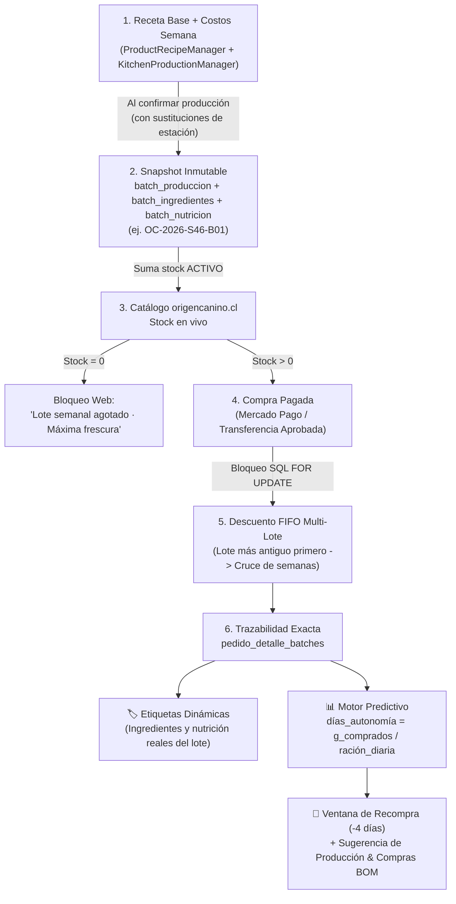

# 🥩 Especificación Técnica Ordenada: Lotes Semanales, Trazabilidad, Stock FIFO y Predicción de Demanda

**Proyecto:** Origen Canino (`origencanino.cl`)  
**Fecha:** 15 de Noviembre de 2026  
**Estado:** 🟡 Análisis Arquitectónico & Propuesta Ampliada (Sin modificaciones de código)  
**Integración Base Detectada en Repositorio:** `backend/server_db.py`, `backend/main.py`, `KitchenProductionManager.jsx`, `ProductRecipeManager.jsx`, `ProductLabelGenerator.jsx`, `NutritionLabel.jsx`, `CartDrawer.jsx`, `CheckoutModal.jsx`

---

## 1. Diagnóstico de Integración con la Arquitectura Actual
Tu proyecto ya cuenta con piezas clave sobre las que este módulo se monta de forma natural:
- **Tablas existentes:** `products`, `ingredients`, `product_ingredients`, `kitchen_cost_history`, `ingredient_price_history`, `orders`, `order_items`, `customers`, `customer_dogs`, `system_settings`.
- **Regla de pedido mínimo (`$30.000 CLP`):** Ya implementada en `CartDrawer.jsx`, `CheckoutModal.jsx` y `backend/main.py` (`MIN_PURCHASE_AMOUNT = 30000`).
- **Módulo de costos y recetas:** `KitchenProductionManager.jsx` + `ProductRecipeManager.jsx` + generadores de etiquetas (`ProductLabelGenerator.jsx` / `NutritionLabel.jsx`).

La gran mejora de esta especificación es **desacoplar la "Receta Plantilla" de la "Producción Real de la Semana"**, convirtiendo cada lote semanal en un **snapshot inmutable** que gobierna stock, costos, etiquetas y trazabilidad ante el cliente.

---

## 2. Diagrama del Flujo Completo

---

## 3. Arquitectura de Datos (4 Tablas Nuevas)

### 3.1. `batch_produccion` (Lote Semanal Inmutable)
| Campo | Tipo | Descripción |
| :--- | :--- | :--- |
| `id` | `SERIAL / UUID` | PK del lote |
| `codigo_lote` | `TEXT UNIQUE` | Autogenerado, ej. `OC-2026-S46-B01` |
| `producto_id` | `INTEGER FK` | Referencia a `products(id)` |
| `linea_produccion` | `TEXT` | `'BARF'` o `'COCIDO'` |
| `semana_fabricacion` | `TEXT` | ISO `YYYY-Www` (ej. `2026-W46`) |
| `fecha_elaboracion` | `DATE` | Fecha local Chile (`America/Santiago`) |
| `fecha_consumo_preferente` | `DATE` | Calculada según regla de línea (`BARF` vs `COCIDO`) |
| `peso_crudo_total_gramos` | `INTEGER` | *(Sugerencia)* Peso bruto ingresado antes de cocción/merma |
| `stock_inicial_gramos` | `INTEGER` | Total envasado vendible en gramos |
| `stock_disponible_gramos` | `INTEGER` | Saldo vivo descontado por ventas FIFO |
| `costo_total_batch_clp` | `INTEGER` | Vinculado a `kitchen_cost_history` de esa semana |
| `estado` | `TEXT` | `'ACTIVO'`, `'AGOTADO'`, `'CERRADO'` |
| `created_at` | `TIMESTAMP` | Marca de creación |

### 3.2. `batch_ingredientes` (Snapshot de Insumos Usados)
Congela la composición real de ese lote (`codigo_lote`), inmune a ediciones futuras del catálogo:
- `id`, `batch_id (FK)`, `ingrediente_id`, `nombre_ingrediente`, `cantidad_gramos`, `porcentaje_formula`, `costo_unitario_clp`.

### 3.3. `batch_nutricion` (Snapshot Nutricional del Lote)
Calculado y congelado al momento de crear el batch a partir de `batch_ingredientes`:
- `batch_id (PK/FK)`, `proteina_pct`, `grasa_pct`, `fibra_pct`, `humedad_pct`, `cenizas_pct`, `calcio_pct`, `fosforo_pct`, `kcal_100g`.

### 3.4. `pedido_detalle_batches` (Trazabilidad FIFO por Ítem de Pedido)
Registra exactamente cuántos gramos de cada lote salieron para cada ítem vendido:
- `id`, `order_id (FK)`, `order_item_id (FK)`, `batch_id (FK)`, `codigo_lote`, `gramos_descontados`, `created_at`.

---

## 4. Reglas Operativas Ordenadas por Pilar

1. **Pilar 1 — Creación de Lote Semanal:**
   - Precarga desde `product_ingredients`, permite sustituir frutas/proteínas de estación y ajustar porcentajes (validando que la suma sea `100%`).
   - Recalcula tabla nutricional y costo en vivo antes de confirmar; al guardar, congela `batch_ingredientes` y `batch_nutricion`.
2. **Pilar 2 — Descuento FIFO Multi-Lote & Reintegro:**
   - Al confirmar pago (`payment_status = 'Pagado'`), descuenta en orden `fecha_elaboracion ASC` entre lotes `ACTIVO` con saldo `> 0`.
   - Si un lote llega a `0g`, pasa automáticamente a `AGOTADO` y el remanente se descuenta del lote siguiente (`Semana 45 -> Semana 46`).
   - Todo queda grabado en `pedido_detalle_batches` (si el pedido se anula antes de despacho, se reintegra al mismo `batch_id`).
3. **Pilar 3 — Etiquetas Dinámicas por Lote:**
   - `ProductLabelGenerator.jsx` y `NutritionLabel.jsx` leen exclusivamente de `batch_ingredientes`, `batch_nutricion` y `batch_produccion`.
   - Si un pedido cruza 2 lotes por FIFO, imprime las etiquetas separadas con el código de lote y tabla nutricional real de cada uno.
4. **Pilar 4 — Tienda Web (`origencanino.cl`) & Alerta de `$30.000 CLP`:**
   - Catálogo web muestra stock vivo (`SUM(stock_disponible_gramos)`).
   - Al llegar a `0` (o menor al formato mínimo vendible): bloquea *"Agregar al carrito"*, muestra badge **"Lote semanal agotado"**, mensaje comercial de frescura (*"Pronto tendremos disponible..."*) y botón opcional *"Reservar próximo lote por WhatsApp"*.
   - **Panel Admin:** si `Valor Stock Disponible (kg × precio/kg) < $30.000 CLP` en un producto con ventas recientes, dispara **Alerta de Producción Prioritaria**.
5. **Pilar 5 — Motor Predictivo de Recompra & Proyección Semanal:**
   - Al entregar un pedido: `dias_autonomia = gramos_totales / racion_diaria_total_mascotas`, `fecha_alerta_recompra = fecha_entrega + dias_autonomia - 4 días`.
   - Vista **"Proyección de Demanda y Recompras"** con clientes en ventana de recompra (próximos 7 días o vencidos) + botón rápido `wa.me` + sugerencia de kilos mínimos a producir por menú.

---

## 5. Análisis Crítico: Casos Borde y Ajustes Recomendados (Antes de Programar)

1. **Concurrencia en Ventas Simultáneas (`SELECT ... FOR UPDATE`):**
   - Si dos clientes pagan por Mercado Pago al mismo tiempo el último kilo de un lote, una lectura normal puede generar stock negativo.
   - **Ajuste:** Ejecutar el descuento FIFO dentro de una transacción PostgreSQL bloqueando las filas del lote con `SELECT ... FOR UPDATE`.
2. **Momento Exacto del Descuento: Transferencia Pendiente vs Mercado Pago:**
   - En pedidos por **transferencia**, entre que el cliente crea el pedido (`Pendiente`) y envía el comprobante pueden pasar horas. Si no se reserva temporalmente o no se valida al aprobar, otro cliente podría agotar el stock en la web.
   - **Ajuste recomendado:** Descontar al confirmar pago **y** validar stock disponible al momento de aprobar la transferencia *(o implementar reserva blanda `stock_reservado_gramos` con expiración de 2 horas para transferencias pendientes)*; y si un pedido pagado se cancela, **reintegrar** los gramos exactos registrados en `pedido_detalle_batches`.
3. **Validación por Formato de Envase en Carrito:**
   - Si quedan `750g` disponibles y los formatos son bolsas de `500g` y `1kg`, el cliente no debe poder agregar `1kg` ni `2 × 500g`.
   - **Ajuste:** Validar en `CartDrawer.jsx` y `POST /api/orders` que `sum(gramos_formato * cantidad) <= stock_disponible_gramos`.
4. **Distinción entre Bloqueo Web (`stock == 0`) y Alerta Admin (`< $30.000 CLP`):**
   - Un cliente puede comprar `$18.000` de Menú Pollo + `$15.000` de Menú Cerdo (`$33.000` total, cumpliendo el mínimo de `$30.000`). Por eso en la tienda web solo debe bloquearse un producto cuando su stock es `< formato mínimo` (ej. `< 500g`), mientras que `< $30.000 CLP` opera como **alerta estratégica interna en el Panel Admin** indicando que ese menú por sí solo ya no cubre un pedido mínimo.
5. **Fecha Local de Chile (`America/Santiago`) en Códigos de Lote:**
   - Usar `ZoneInfo("America/Santiago")` para `semana_fabricacion` (`YYYY-Www`) y `fecha_elaboracion`, evitando saltos de semana/día después de las 21:00 hrs.

---

## 6. Nuevas Ideas y Funciones Complementarias Recomendadas

1. **🛒 Lista Automática de Compras de Insumos Semanal (Explosión BOM):**
   - A partir de la *"Sugerencia Consolidada de Producción Semanal"* (ej. producir `32 kg` de Pollo & Corazón + `20 kg` de Cocido Cerdo), calcular automáticamente **cuántos kilos de cada ingrediente** (pechuga, corazón, hígado, zanahoria, arándanos, etc.) necesitas comprar esa semana y su presupuesto estimado según `ingredients`.
2. **🔥 Control de Merma Real en Cocina (Cocido vs BARF):**
   - En menús **Cocidos**, la carne y vegetales pierden entre `15%` y `25%` de peso por evaporación al cocinar. Registrar `peso_crudo_total_gramos` vs `stock_inicial_gramos` (envasado final) permite calcular automáticamente el **% de merma real**, ajustar el costo por kg terminado y reflejar nutrientes concentrados sobre el producto final cocido.
3. **🔎 Trazabilidad Inversa / "Recall" por Lote + QR en Etiqueta:**
   - Buscador rápido en Admin donde ingresas `OC-2026-S46-B01` y ves al instante la lista de **todos los clientes y pedidos que recibieron ese lote** (indispensable ante cualquier reclamo o alerta de un proveedor de proteínas).
   - Opcionalmente, un pequeño **QR en la etiqueta física** que lleve al tutor a ver la fecha de elaboración y composición real de ese lote.
4. **📲 Lista de Espera / "Avísame cuando haya nuevo lote":**
   - Cuando un menú aparezca como *"Lote semanal agotado"*, permitir dejar WhatsApp o correo (1 clic). Al registrar el nuevo batch de la semana en Admin, mostrar la lista de interesados listos para contactar en 1 toque.
5. **⏳ Alerta Temprana de Vencimiento:**
   - Si un lote próximo a cumplir su `fecha_consumo_preferente` aún tiene saldo, destacarlo en amarillo/rojo en el panel para priorizar promociones o despacho antes de merma.
6. **📉 Radar de Deserción (Clientes que pasaron su fecha de recompra):**
   - Complementar la ventana de *"próximos 7 días"* con una pestaña de **"Clientes Atrasados (> +5 días de su fecha estimada)"** para recuperar ventas antes de que compren en la competencia.

---

## 7. Módulo Complementario: Links de Pago Directo (Pedidos Asistidos y Cobro Post-Entrega)

### 7.1. Problema Operativo Detectado
Existen clientes (especialmente personas de **tercera edad** o clientes que no desean navegar la web) que realizan sus pedidos de forma asistida (por teléfono o WhatsApp). En muchos casos, el alimento ya fue entregado y **aún no se ha concretado el pago** tras varios días, generando cuentas por cobrar abiertas, pérdida de tiempo operativo y riesgo de pérdida de cliente.

### 7.2. Funcionalidad Requerida: Generador de Link con Carrito / Cobro Precargado
Desde el Panel Admin, poder generar un **link único y directo** para enviar al cliente (ej. vía WhatsApp), con las siguientes reglas estrictas:
1. **Detalle exacto de kilos y menús:** Precarga exactamente los productos y kilos comprados/entregados al cliente.
2. **Precio pleno (Cero descuentos):** Estos links se emiten **sin ningún tipo de descuento, cupón ni promoción** (`descuento = 0`, precio lista duro).
3. **Flujo directo a pasarela de pago:** Al abrir el link, el cliente aterriza **directamente con el carrito ya lleno y listo para pagar** (sin tener que buscar productos ni armar el pedido).
4. **Pasos mínimos del cliente:**
   - Iniciar sesión o crear su cuenta de usuario (si aún no tiene).
   - Confirmar / completar sus datos de cliente.
   - Seleccionar medio de pago (**Mercado Pago** o **Transferencia Bancaria**) y pagar.

### 7.3. Regla Crítica de Integración con Stock FIFO (Evitar Doble Descuento)
Para que este módulo conviva sin errores con los **Lotes Semanales (FIFO)**, se deben distinguir **dos modos** al generar el link desde Admin:

| Modo del Link | Cuándo se usa | Comportamiento con Inventario FIFO |
| :--- | :--- | :--- |
| **A. Pedido Asistido (Previo a entrega)** | El cliente llamó/escribió para pedir, pero aún no se despacha ni se paga. | Precarga el carrito en la web (`/checkout?link=...`). El stock FIFO se descuenta **al momento de confirmarse el pago** en Mercado Pago o al aprobar la transferencia. |
| **B. Cobro de Pedido Ya Entregado (Post-entrega)** | El alimento **ya salió de cocina/bodega y fue entregado** al cliente, pero sigue impago (`payment_status = 'Pendiente'`). | El link apunta a un `order_id` existente cuyo stock **ya fue descontado de su batch FIFO al momento del despacho**. Al pagar por Mercado Pago o transferencia, **solo actualiza el pago a `Pagado`** (sin volver a descontar stock). |

### 7.4. Sugerencias Técnicas de Diseño (Para Reducir Fricción en Tercera Edad)
- **Bloqueo de edición en el carrito precargado:** Cuando el cliente entra por un link de cobro post-entrega, los ítems y montos vienen bloqueados (solo lectura) para evitar que modifique kilos o aplique cupones por error antes de pagar.
- **Expiración y trazabilidad del link:** Cada link lleva un token único (`payment_link_token`), fecha de creación y registro de si fue abierto o pagado, visible en el Panel Admin para hacer seguimiento de cobranza en 1 clic.
- **Recordatorio amable por WhatsApp:** Botón en Admin para reenviar el mismo link con mensaje prearmado cuando un pedido entregado lleve más de `48 hrs` pendiente de pago.

