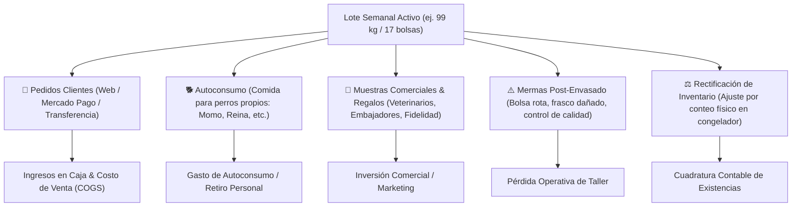

# 📋 Propuesta de Solución: Ajuste de Stock, Salidas No Comerciales y Edición de Lotes FIFO

**Proyecto:** Origen Canino (`origencanino.cl`)  
**Autor:** Antigravity AI & Patricio Padilla (PPV Soluciones)  
**Fecha:** Martes 17 de Noviembre de 2026  
**Contexto Operativo:** Validación exitosa del lote semanal de *Patitas Deshidratadas* (17 bolsas envasadas y bloqueadas exactamente a 17 unidades en la tienda online).

---

## 1. 🎯 Diagnóstico y Necesidad Operativa

En la operación diaria de la cocina y taller de Origen Canino, **no todo el inventario que sale de un lote semanal corresponde a una venta comercial a clientes**. 

Existen 4 tipos de salidas operativas habituales identificadas por Patricio:



### El Problema de la Edición "Ciega":
Si simplemente pusiéramos un campo de texto que sobreescriba el número de stock (`99 kg` $\rightarrow$ `90 kg`):
1. **Pérdida de Trazabilidad:** Nadie sabría qué pasó con esos 9 kg faltantes (¿se perdieron?, ¿se robaron?, ¿se vendieron en efectivo?, ¿se los comieron los perros?).
2. **Descuadre en Finanzas:** El costo de producir esos 9 kg (ej. \$55.800 CLP) quedaría "flotando", distorsionando el margen real del negocio.
3. **Falta de Trazabilidad Sanitaria:** Si un veterinario pide la trazabilidad de un lote, debe quedar constancia de cada gramo producido.

---

## 2. 💡 Enfoque Recomendado: Modal "Editar Lote & Ajustar Stock"

Proponemos añadir el botón **`[✏️ Editar Lote]`** en la columna de acciones de la tabla FIFO (junto a *Ver Lote*, *Etiqueta*, *Cerrar*, *Eliminar*).

Al presionar este botón, se abre un **Modal Inteligente** con dos secciones claras:

### Sección A: Salida Manual / Ajuste de Stock (Uso Diario)
Permite descontar o ajustar stock sin generar una orden de compra:

1. **Unidad Adaptativa según Producto:**
   - Si el lote es de **BARF** o **Cocinado:** permite ingresar en **Kilos** (ej. `9.0 kg`).
   - Si el lote es de **Snacks (400 g)** o **Caldos (500 ml):** permite ingresar en **Bolsas / Frascos** o en **Kilos**, convirtiendo automáticamente:
     $$\text{Ejemplo: } 2\text{ bolsas de patitas} = 0.8\text{ kg descontados}$$

2. **Selector de Motivo con 1 Clic (Badges Visuales):**
   - 🐕 **Autoconsumo:** *Alimentación de perros propios / taller.*
   - 🎁 **Muestra / Regalo:** *Entrega comercial a veterinario aliado, embajador o atención a cliente.*
   - ⚠️ **Merma / Rotura:** *Bolsa dañada, pérdida de vacío o rotura de frasco.*
   - ⚖️ **Ajuste de Conteo Físico:** *Corrección tras conteo real en el congelador.*
   - ➕ **Ingreso Adicional:** *Aumentar stock disponible si hubo re-envasado.*

3. **Calculadora de Impacto en Vivo:**
   - Muestra: `Stock actual: 99.0 kg` $\rightarrow$ `Nuevo stock: 90.0 kg`.
   - Valorización: *Costo del lote asignado a esta salida: \$55.800 CLP.*
   - Campo para Nota opcional: *"Semana para Momo y Reina"*.

### Sección B: Edición de Parámetros del Lote (Administrativo)
- **Fecha de Consumo Preferente:** Por si se extiende o acorta la vigencia tras pruebas de laboratorio o congelación especial.
- **Notas de Producción:** Modificar notas internas o aclaraciones de lote.

---

## 3. 🛠️ Arquitectura Técnica y Base de Datos

### 3.1. Nueva Tabla PostgreSQL: `batch_ajustes_stock`
Para que todo quede auditado y respaldado:

```sql
CREATE TABLE IF NOT EXISTS batch_ajustes_stock (
    id SERIAL PRIMARY KEY,
    batch_id INTEGER NOT NULL REFERENCES batch_produccion(id) ON DELETE CASCADE,
    tipo_movimiento VARCHAR(30) NOT NULL, -- 'AUTOCONSUMO', 'MUESTRA_REGALO', 'MERMA', 'CONTEO_FISICO', 'OTRO'
    cantidad_gramos INTEGER NOT NULL,      -- Valor positivo o negativo
    unidades_equivalentes INTEGER DEFAULT 0, -- Ej: -2 bolsas
    costo_unitario_kg_clp INTEGER NOT NULL,
    costo_total_ajuste_clp INTEGER NOT NULL,
    motivo_detalle TEXT,
    usuario TEXT DEFAULT 'admin',
    created_at TIMESTAMP DEFAULT CURRENT_TIMESTAMP
);

CREATE INDEX IF NOT EXISTS idx_batch_ajustes_batch ON batch_ajustes_stock(batch_id);
```

### 3.2. Endpoints Backend FastAPI (`backend/batch_routes.py`)
1. **`POST /api/admin/batches/{batch_id}/adjust-stock`**
   - Recibe: `{ tipo_movimiento, cantidad_gramos, motivo_detalle }`.
   - Valida que `stock_disponible_gramos + cantidad_gramos >= 0`.
   - Aplica `UPDATE batch_produccion SET stock_disponible_gramos = stock_disponible_gramos + ...`.
   - Si el stock llega a 0, actualiza automáticamente el estado a `'AGOTADO'`.
   - Inserta el registro inmutable en `batch_ajustes_stock`.
   - Retorna el nuevo stock disponible y el registro del ajuste.

2. **`PATCH /api/admin/batches/{batch_id}`**
   - Permite actualizar fecha de vencimiento y notas generales.

3. **`GET /api/admin/batches/{batch_id}/movements`**
   - Devuelve la trazabilidad completa del lote: tanto pedidos despachados (`pedido_detalle_batches`) como salidas manuales (`batch_ajustes_stock`).

---

## 4. 📊 Integración con el Módulo de Finanzas (Conexión Directa)

Esta solución resuelve exactamente la meta de hoy para el módulo de Finanzas:

| Movimiento de Stock | Impacto en Tienda Online | Tratamiento en Módulo Finanzas |
| :--- | :--- | :--- |
| **Venta Web (Pedido #)** | Descuenta stock FIFO | **Ingreso en Caja + Costo de Venta (COGS)** $\rightarrow$ Margen comercial directo. |
| **Autoconsumo (Perros propios)** | Descuenta stock FIFO | **Gasto Operativo / Retiro:** Se registra el costo de insumos (\$6.200/kg) sin ensuciar las ventas comerciales. |
| **Muestra / Regalo Comercial** | Descuenta stock FIFO | **Inversión en Marketing / Relaciones Públicas:** Permite saber cuánto invertimos en captar clientes o alianzas. |
| **Merma / Rotura** | Descuenta stock FIFO | **Pérdida Operativa de Cocina:** Permite medir el % de merma en taller y corregir empaques. |

---

## 5. 🖥️ Visualización en la UI

### En la Tabla FIFO:
```text
[Ver Lote]  [✏️ Editar]  [Etiqueta]  [Cerrar]  [Eliminar]
```

### En el Modal "Ver Lote":
Al abrir la ficha de un lote, se añade la solapa o tarjeta:
- **Trazabilidad de Consumo del Lote:**
  - 🛒 *Pedido #5:* -10 kg (Venta Despachada)
  - 🐕 *Autoconsumo:* -9 kg (Comida Momo y Reina)
  - 🎁 *Muestra:* -0.8 kg / 2 bolsas (Veterinaria Pet Point)
  - 📦 *Stock Restante:* 80.2 kg disponibles.

---

## 6. 🚀 Plan de Ejecución Inmediato

Una vez que revises esta propuesta:
1. **Paso 1:** Crear la tabla `batch_ajustes_stock` en PostgreSQL.
2. **Paso 2:** Crear el endpoint de ajuste y edición en `backend/batch_routes.py` y `batch_service.py`.
3. **Paso 3:** Implementar el modal `BatchAdjustModal.jsx` y el botón `[✏️ Editar]` en `BatchProductionManager.jsx`.
4. **Paso 4:** Actualizar el modal de detalle `Ver Lote` para mostrar los consumos no comerciales.
5. **Paso 5:** Compilar, desplegar en Hetzner y probar en vivo sacando un kilo de prueba.

