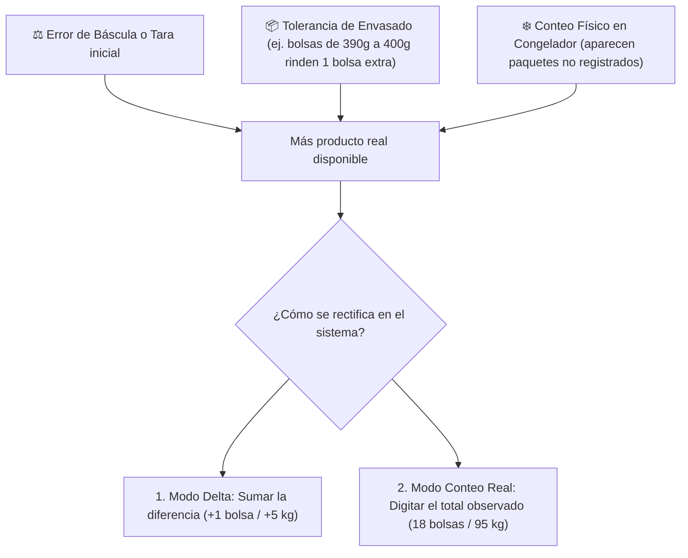

# 📈 Rectificación de Stock Hacia Arriba: Sobrantes, Errores de Báscula y Conteo Físico Real

**Proyecto:** Origen Canino (`origencanino.cl`)  
**Autor:** Antigravity AI & Patricio Padilla (PPV Soluciones)  
**Fecha:** Martes 17 de Noviembre de 2026  
**Contexto:** Casos donde el stock real observado es mayor al registrado inicialmente (ej. 17 bolsas registradas pero salen 18 al envasar; o 90 kg en sistema pero al auditar el congelador hay 95 kg).

---

## 1. 🔍 Análisis del Problema Operativo Inverso

En la cocina y taller ocurren situaciones donde el inventario real disponible supera lo que se pesó o estimó originalmente:



### Causas Frecuentes en Origen Canino:
1. **Desviación de Báscula o Tara:** Se pesaron 7.0 kg brutos, pero al dosificar con precisión en bolsas de 400 g salieron **18 bolsas** (7.2 kg reales).
2. **Conteo Físico Post-Producción:** El sistema marcaba 90 kg de BARF disponibles (tras despachos anteriores), pero al revisar físicamente el congelador hay **95 bolsas de 1 kg** (alguien guardó 5 kg no registrados).

---

## 2. ⚡ ¿Cómo Funciona Ahora Mismo en Producción?

Con la actualización que acabamos de desplegar hace unos minutos en [origencanino.cl/admin](https://origencanino.cl/admin), **ya es posible rectificar hacia arriba**:

1. En la tabla FIFO, haces clic en **`[✏️ Editar]`** del lote correspondiente.
2. En la solapa de stock, seleccionas el botón verde:  
   **`[➕ Ingreso / Reingreso (Sumar)]`**.
3. El motivo se preselecciona automáticamente como **`⚖️ Conteo Físico (Auditoría en congelador)`**.
4. Ingresas la cantidad que sobra:
   - Para snacks: seleccionas `Bolsas` y escribes `1`.
   - Para BARF: seleccionas `Kg` y escribes `5.0`.
5. En la nota anotas: *"Corrección báscula: salieron 18 bolsas en total"* o *"Conteo físico congelador"*.
6. Al presionar **Confirmar Ajuste**:
   - El stock disponible sube de 17 a 18 bolsas (o de 90 a 95 kg).
   - Si el lote estaba en estado `AGOTADO`, el backend lo **reactiva automáticamente a `ACTIVO`** para que vuelva a estar disponible en la web.
   - En el modal `Ver Lote`, queda registrado: `+1 bolsa (+0.40 kg) • ⚖️ Conteo Físico`.

---

## 3. 💡 Propuesta de Mejora: "Modo Conteo Físico Real" (Target vs. Delta)

Actualmente, el operador debe hacer una pequeña resta mental:
$$\text{Stock visto (18)} - \text{Stock en sistema (17)} = +1\text{ bolsa a sumar}$$

Para hacer la operación **cero-fricción**, proponemos evolucionar el modal a dos modos de entrada con una palanca (*toggle*):

```text
[ Modo: Conteo Físico Real ]   o   [ Modo: Sumar/Restar Diferencia ]
```

### ¿Cómo opera el "Modo Conteo Físico Real"?
1. Abres el modal `[✏️ Editar]`.
2. El modal te dice:  
   `Stock actual en sistema: 17 bolsas (7.0 kg)`
3. Ves una sola casilla grande y clara:  
   **`¿Cuántas bolsas / kilos hay realmente ahora?: [ 18 ]`**
4. El sistema calcula solo y en tiempo real:
   > 🟢 **Ajuste automático detectado:** $+1\text{ bolsa (+0.40 kg)}$.  
   > ℹ️ *El stock aumentará de 17 a 18 bolsas disponibles en tienda.*
5. Presionas **`[Confirmar Conteo Real]`** y listo. No tienes que calcular restas ni preocuparte de si es más o menos.

---

## 4. 💰 Impacto Financiero de un Ajuste Hacia Arriba

Cuando aparecen más unidades o kilos de los previstos inicialmente, el impacto contable es sumamente positivo:

| Métrica | Inicial (17 bolsas) | Rectificado (18 bolsas) | Beneficio para el Negocio |
| :--- | :--- | :--- | :--- |
| **Costo Total del Lote** | \$62.000 CLP | \$62.000 CLP | El costo de insumos y luz ya se pagó. |
| **Costo Real por Bolsa** | **\$3.647 / bolsa** | **\$3.444 / bolsa** | **El costo unitario baja en -\$203/bolsa**, porque el gasto fijo se reparte en más producto. |
| **PVP por Bolsa** | \$6.000 CLP | \$6.000 CLP | Precio de venta al cliente. |
| **Margen Bruto Unitario** | +39.2% | **+42.6%** | **El margen comercial sube en +3.4%**. |
| **Venta Total Proyectada** | \$102.000 CLP | **\$108.000 CLP** | **+\$6.000 CLP de ingresos extra** para la cocina. |

En el módulo de Finanzas, esto se clasifica como:
* **Ganancia por Eficiencia de Envasado / Sobrante de Inventario**.

---

## 5. 🛠️ Opciones para Patricio:

* **Opción 1 (Inmediata - Ya disponible):**  
  Usar el botón verde **`[➕ Ingreso / Reingreso (Sumar)]`** que ya tienes activo en el panel, digitando `1` en bolsas o `5` en kilos cuando sobren.
* **Opción 2 (Automatización Cero-Cálculo):**  
  Añadir al modal la casilla de **"Conteo Físico Real"**, donde solo ingresas el número total que contaste con tus ojos (ej. `18` o `95`) y el sistema computa el delta automáticamente.

